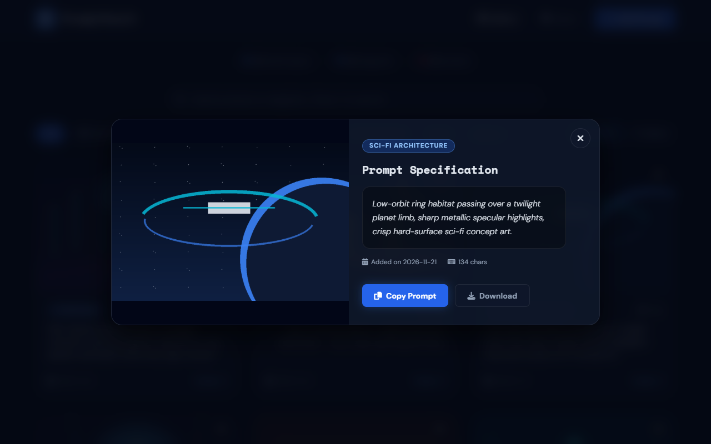

<div align="center">
  
  <h1>PromptVault</h1>
  <h3>Prompt Library &amp; Image Asset Manager</h3>
  <p>CS50x Final Project by <a href="https://github.com/Adel-dev-2001"><strong>Adel Mohamed</strong></a></p>
  <p>
    <a href="https://github.com/Adel-dev-2001/PromptVault/actions/workflows/ci.yml"></a>
    <a href="https://www.python.org/"></a>
    <a href="https://flask.palletsprojects.com/"></a>
    <a href="https://www.sqlite.org/"></a>
    <a href="LICENSE"></a>
  </p>
  <p>
    <a href="https://adel-dev-2001.github.io/PromptVault/"><strong>Static Browser Demo (GitHub Pages)</strong></a> |
    <a href="https://youtu.be/-prDHVKBQtc"><strong>Video Demonstration</strong></a> |
    <a href="https://github.com/Adel-dev-2001/PromptVault"><strong>Source Repository</strong></a>
  </p>
</div>

> The hosted GitHub Pages link opens a static browser demo ([index.html](index.html) and [static/js/demo.js](static/js/demo.js)) that stores entries in your browser's `localStorage` with no backend. The primary application documented below is the Flask and SQLite server ([app.py](app.py)), which stores uploaded images on disk under `static/uploads/`, checks CSRF tokens, verifies image bytes with Pillow, and persists records in SQLite.

---

## Overview

PromptVault stores generated images alongside the prompt text, negative prompts, or model parameters used to produce them, organized by category. Built by Adel Mohamed as a CS50x Final Project, it is a single-user local web tool for cataloging existing images and prompt text. It does not generate images, call external AI APIs, or manage multi-user accounts.

---

## Screenshots

Generated with Playwright against a seeded local Flask instance:

| Desktop Gallery (1280×800) | Prompt Detail Modal (1280×800) |
| :---: | :---: |
|  |  |

<p align="center">
  <strong>Mobile View with Navigation Menu (390×844)</strong><br />
  
</p>

---

## Features

- Browse saved prompts and artworks in a gallery paginated at 24 entries per page, with totals for prompts, categories, and favorites.
- Search prompts and categories (press `/` to jump to the search box), filter by category or favorites, and switch between newest and oldest order.
- Open any entry in a detail modal to inspect the full prompt, copy it to the clipboard, or download the original image file, with keyboard focus trapping and Escape to close.
- Upload PNG, JPEG, GIF, or WebP images up to 10 MB through a file picker or drag-and-drop area with live preview and a character counter.
- Edit prompt text, move entries between categories, toggle favorites, and delete entries together with their stored image files.
- Organize entries with Unicode category names (including Arabic, Persian, and accented letters), automatic right-to-left text direction, and a collapsible navigation menu on small screens.

---

## Architecture

The server is a single Flask module ([app.py](app.py)) backed by one SQLite table (`images`, queried via `cs50.SQL`) and server-rendered Jinja2 templates (`templates/`), including custom HTML error pages for HTTP 400, 404, 405, 413, and 500. Uploaded images are written under `static/uploads/<Category>/` using `secure_filename` (appending `_1`, `_2`, ... on collisions), while SQLite stores only relative `Category/file.ext` paths. A startup migration rewrites any legacy `/static/uploads/...` rows, templates generate URLs through `url_for`, and relative `DATABASE_PATH` values resolve from `app.root_path`, so mounting under a `SCRIPT_NAME` prefix or starting from another working directory keeps paths consistent. If an `INSERT` fails after saving an image, the file is deleted; changing a category moves the file and removes empty old folders, or returns HTTP 400 if the file is missing on disk.

Gallery queries escape SQL `LIKE` wildcards (`%`, `_`, `\`), compute totals with `COUNT(*)` and `SUM`, paginate at 24 entries per page (`?page=N`), redirect out-of-range page numbers (`page > total_pages`) to the last page with HTTP 302, and embed only the current page's items in a `<script type="application/json">` element instead of inline event handlers. Unfiltered paginated pages stay indexable with self-canonical URLs and `<link rel="prev">` / `<link rel="next">` links, while filtered views, `/add`, and `/edit` emit `noindex, follow`. `/robots.txt` and `/sitemap.xml` are served dynamically, using the latest entry date for `/` and the `ABOUT_LASTMOD` constant for `/about`.

Interactive behavior lives in three deferred scripts under `static/js/` with no frontend build step: `main.js` manages the shared focus-trapping modal controller, mobile menu toggle, responsive search placeholder, delete confirmation, and clipboard fallback; `gallery.js` reads the JSON dataset; and `form.js` handles previews, tag pills, and character counts. Tracked CSS, JS, and icon files are served with a content-hashed `?v=` query parameter and `Cache-Control: public, max-age=31536000, immutable`. Uploaded images under `/static/uploads/` are served with `Cache-Control: public, max-age=3600, must-revalidate` and rely on Flask's `ETag` for conditional revalidation. HTML pages with forms (`/`, `/add`, `/edit/<id>`) send `Cache-Control: no-store`. The root [index.html](index.html) and [static/js/demo.js](static/js/demo.js) form a separate static-only browser demo for GitHub Pages.

---

## Quick Start

### Prerequisites

- Python 3.11 - 3.13 (tested in CI; the Docker image uses `python:3.13-slim`).
- `pip`.

### Local Development

```bash
git clone https://github.com/Adel-dev-2001/PromptVault.git
cd PromptVault
python -m venv .venv
```

Activate the virtual environment:

- Windows (PowerShell): `.\.venv\Scripts\Activate.ps1`
- macOS / Linux: `source .venv/bin/activate`

Install dependencies and start the server:

```bash
pip install -r requirements.txt
python app.py
```

Open `http://127.0.0.1:5000`. When `APP_ENV` is unset or `development` under `python app.py`, a missing or placeholder `SECRET_KEY` generates a temporary key and logs one startup warning.

### Production Mode

When `APP_ENV=production`, startup raises `RuntimeError` unless `SECRET_KEY` is set to a non-placeholder string of at least 32 characters. `wsgi.py`, `Procfile` (`web: APP_ENV=production gunicorn wsgi:app`), and `Dockerfile` all set `APP_ENV=production` by default:

```bash
export APP_ENV=production
export SECRET_KEY="$(python -c 'import secrets; print(secrets.token_hex(32))')"
gunicorn --workers 4 --bind 127.0.0.1:5000 wsgi:app
```

`gunicorn==27.0.1` is pinned in `requirements.txt` for POSIX/Linux deployments.

---

## Configuration

| Variable | Default | Purpose |
| :--- | :--- | :--- |
| `APP_ENV` | `development` (`production` in `wsgi.py`, `Procfile`, `Dockerfile`) | Enables mandatory `SECRET_KEY` validation and `SESSION_COOKIE_SECURE` when set to `production`. |
| `SECRET_KEY` | Temporary random key in local dev | Signs Flask sessions and CSRF tokens. Must be at least 32 characters and non-placeholder in production. |
| `DATABASE_PATH` | `<app_root>/prompts.db` (`/app/data/prompts.db` in Docker) | SQLite database path; relative values resolve from `app.root_path`. Commented out in `.env.example`. |
| `APP_PASSWORD` | Empty (disabled) | When non-empty, requires HTTP Basic auth (`hmac.compare_digest`, username ignored) on all routes including `/static/uploads/`, exempting only `/robots.txt` and public `/static/` assets. |
| `HOST` | `127.0.0.1` | Bind address for `python app.py`. |
| `PORT` | `5000` | Listen port for `python app.py`. |
| `FLASK_DEBUG` | `0` | Enables Flask debug reloader and debugger when set to `1`. |
| `TRUST_PROXY` | `0` | Enables Werkzeug `ProxyFix` (`x_for=1`, `x_proto=1`, `x_host=1`, `x_prefix=1`) when set to `1` behind a reverse proxy. |

See [.env.example](.env.example) for a template.

---

## Running Tests and Lint Checks

Run the `unittest` suite (uses isolated temporary directories and leaves no repository artifacts):

```bash
python -m unittest -v test_app.py
```

Install development tooling and run Ruff and dependency audit checks:

```bash
pip install -r requirements-dev.txt
ruff check .
ruff format --check .
pip-audit -r requirements.txt
```

Regenerate PNG social card and icon assets if needed:

```bash
python scripts/make_social_card.py
```

---

## Docker

The repository includes a single-stage `Dockerfile` (`python:3.13-slim`), `.dockerignore`, and `docker-compose.yml`. The image runs as non-root user `appuser` owning `/app/data` and `/app/static/uploads`, sets `APP_ENV=production` and `DATABASE_PATH=/app/data/prompts.db`, and runs a Python `urllib.request` health check against `http://127.0.0.1:5000/robots.txt`. `docker-compose.yml` binds `127.0.0.1:5000:5000` only and requires `SECRET_KEY` from the host environment.

```bash
export SECRET_KEY="$(python -c 'import secrets; print(secrets.token_hex(32))')"
docker compose up -d --build
```

> **Local Docker cookie note:** Production mode sets `SESSION_COOKIE_SECURE=True`. When using the Docker container locally over plain HTTP, open `http://localhost:5000` in Chrome or Firefox (which treat `localhost` as a trustworthy origin for `Secure` cookies); Safari may drop the session cookie on plain HTTP, causing CSRF form errors.

---

## Project Structure

```text
PromptVault/
├── .dockerignore                  # Excludes local DBs, .env, .git, docs, dev deps, uploads, caches
├── .editorconfig                  # UTF-8, LF, trailing newline, 4-space Python / 2-space web rules
├── .env.example                   # Environment variable template (DATABASE_PATH commented out)
├── .gitattributes                 # Forces LF line endings on text files and marks binary image formats
├── .github/
│   ├── dependabot.yml             # Weekly Dependabot updates for pip and github-actions
│   └── workflows/
│       └── ci.yml                 # Ruff, pip-audit, unit tests (3.11-3.13), Docker build + curl /
├── .gitignore                     # Ignores venvs, DB files, .env, caches, and uploaded images
├── .nojekyll                      # Serves static GitHub Pages files without Jekyll processing
├── 404.html                       # Static fallback 404 page for GitHub Pages
├── CHANGELOG.md                   # Release history
├── Dockerfile                     # Single-stage python:3.13-slim non-root container image
├── LICENSE                        # MIT License
├── Procfile                       # Process command (APP_ENV=production gunicorn wsgi:app)
├── README.md                      # Project documentation
├── app.py                         # Flask routes, SQL queries, validation, headers, pagination, SEO
├── docker-compose.yml             # Localhost-bound Compose service with persistent volumes
├── docs/
│   └── screenshots/
│       ├── gallery.png            # Playwright desktop gallery screenshot
│       ├── mobile.png             # Playwright mobile view screenshot
│       └── modal.png              # Playwright detail modal screenshot
├── index.html                     # Static browser demo page for GitHub Pages
├── pyproject.toml                 # Ruff configuration (line-length = 100)
├── requirements-dev.txt           # Pinned dev tools (ruff, pip-audit)
├── requirements.txt               # Pinned runtime Python dependencies including gunicorn
├── robots.txt                     # Static robots directives for GitHub Pages demo
├── scripts/
│   └── make_social_card.py        # Pillow generator for og-card.png and PNG app icons
├── sitemap.xml                    # Static sitemap with <lastmod> for GitHub Pages demo
├── static/
│   ├── apple-touch-icon.png       # 180x180 PNG icon for iOS home screen
│   ├── favicon.svg                # Vector site icon
│   ├── icon-192.png               # 192x192 PNG manifest icon
│   ├── icon-512.png               # 512x512 PNG manifest icon
│   ├── icon-maskable-512.png      # 512x512 maskable icon with safe-zone margin
│   ├── js/
│   │   ├── demo.js                # Client-side localStorage demo script for root index.html
│   │   ├── form.js                # Add/Edit character counter, tag pills, drag-and-drop preview
│   │   ├── gallery.js             # JSON dataset loader, clipboard delegation, and detail modal wiring
│   │   └── main.js                # Async CSS loader, toast/copy, modal focus controller, mobile nav
│   ├── manifest.json              # Web app manifest
│   ├── og-card.png                # 1200x630 Open Graph / Twitter preview card
│   ├── styles.css                 # Application styles
│   └── uploads/
│       └── .gitkeep               # Keeps uploads directory tracked while uploads are ignored
├── templates/
│   ├── about.html                 # Application overview and security model page
│   ├── add.html                   # Upload form
│   ├── edit.html                  # Prompt/category edit form
│   ├── errors/
│   │   ├── 400.html
│   │   ├── 404.html
│   │   ├── 405.html
│   │   ├── 413.html
│   │   └── 500.html
│   ├── index.html                 # Paginated gallery template
│   └── layout.html                # Base layout template
├── test_app.py                    # Automated unit test suite
└── wsgi.py                        # WSGI entry point
```

---

## Security Model

PromptVault is designed as a single-user local tool by default.

### What is protected

- All `POST` endpoints (`/add`, `/edit/<id>`, `/favorite/<id>`, `/delete/<id>`) require valid `Flask-WTF` CSRF tokens.
- Setting `APP_PASSWORD` enforces HTTP Basic authentication (compared with `hmac.compare_digest`, username ignored) on every route including `/static/uploads/` and `/download/<path>`; only `/robots.txt` and non-upload static assets under `/static/` stay unauthenticated.
- Uploads are capped at 10 MB, restricted to `png`, `jpg`, `jpeg`, `gif`, and `webp`, verified for matching binary format via Pillow, checked against a 20,000,000-pixel per-frame limit (including animated GIF/WebP frames), and saved with sanitized filenames.
- Category names are NFC-normalized, collapse runs of ASCII spaces, and allow only 1-30 characters from Unicode letters (`L*`), combining marks (`M*`), digits (`N*`), space, `-`, `_`, ZWNJ (`U+200C`), and ZWJ (`U+200D`), rejecting other control/format characters and strings without letters or digits. Upload resolution and `/download/<path>` reject null bytes, backslashes, percent signs (on downloads), and `..` segments, and check `os.path.commonpath` against `UPLOAD_FOLDER`.
- SQL queries bind all user inputs as parameters (`?`), `LIKE` search escapes wildcard characters, Jinja autoescaping prevents HTML/attribute injection, and responses set `Content-Security-Policy` (`script-src 'self'`, `img-src 'self' data: blob:`, no `'unsafe-inline'`), `X-Content-Type-Options: nosniff`, `X-Frame-Options: SAMEORIGIN`, `Referrer-Policy`, `Permissions-Policy`, `Cache-Control: no-store` on form pages, and `Strict-Transport-Security` over HTTPS (with `ProxyFix` when `TRUST_PROXY=1`). `/favorite/<id>` redirects only to same-origin referrers.

### What is not protected

- There are no multi-user accounts or role permissions; `APP_PASSWORD` is a single shared password and ignores the Basic auth username.
- Requests and authentication attempts are not rate-limited.
- There is no content or malware inspection beyond Pillow decoding and format verification.

> Do not expose this application directly to the internet without `APP_PASSWORD` set and a TLS-terminating reverse proxy in front of it (with `TRUST_PROXY=1`).

---

## Known Limitations

- Running multiple Gunicorn workers (`--workers=4`) against SQLite relies on SQLite file locking and is intended for single-user or light traffic rather than concurrent write-heavy loads.
- Animated GIF and WebP uploads check the 20,000,000-pixel ceiling on each individual frame within the 10 MB request limit rather than summing pixel counts across all frames.
- The GitHub Pages static demo (`index.html`) stores entries only in browser `localStorage`, renders all entries on one page without pagination, and cannot perform server-side Pillow byte verification.

---

## Author &amp; License

- Author: Adel Mohamed ([GitHub](https://github.com/Adel-dev-2001))
- License: [MIT License](LICENSE)
