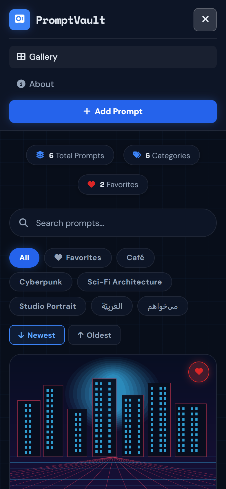

<div align="center">
  
  <h1>PromptVault</h1>
  <h3>Prompt Library &amp; Image Asset Manager</h3>
  <p>CS50x Final Project by <a href="https://github.com/Adel-dev-2001"><strong>Adel Mohamed</strong></a></p>
  <p>
    <a href="https://github.com/Adel-dev-2001/PromptVault/actions/workflows/ci.yml"></a>
    <a href="https://www.python.org/"></a>
    <a href="https://flask.palletsprojects.com/"></a>
    <a href="https://www.sqlite.org/"></a>
    <a href="LICENSE"></a>
  </p>
  <p>
    <a href="https://adel-dev-2001.github.io/PromptVault/"><strong>Static Browser Demo (GitHub Pages)</strong></a> |
    <a href="https://youtu.be/-prDHVKBQtc"><strong>Video Demonstration</strong></a> |
    <a href="https://github.com/Adel-dev-2001/PromptVault"><strong>Source Repository</strong></a>
  </p>
</div>

> **Static Demo vs. Flask Application:** The hosted **GitHub Pages** link opens the static browser demo ([index.html](index.html) and [static/js/demo.js](static/js/demo.js)), which stores entries inside your browser's `localStorage` with no server backend. The primary application documented below is the **Flask + SQLite server** ([app.py](app.py)), which stores uploaded images on disk under `static/uploads/`, checks CSRF tokens, verifies image bytes with Pillow, and persists records in SQLite.

---

## Overview

**PromptVault** stores generated images alongside the exact prompt text, negative prompts, or model parameters used to produce them, organized by category.

### About this project

PromptVault was built by **Adel Mohamed** as a CS50x Final Project. It provides a single-user local web interface for cataloging existing images and prompt text in SQLite, searching entries, and downloading archived files. It intentionally does not generate images, call external AI APIs, or manage multi-user accounts.

### Architecture

The server application is a single Flask module ([app.py](app.py)) backed by one SQLite table (`images`, queried via `cs50.SQL`) and server-rendered Jinja2 templates (`templates/`). Uploaded image files are stored on disk under `static/uploads/<Category>/`, while SQLite records only relative paths (`Category/file.ext`); a startup migration normalizes any legacy `/static/uploads/...` rows, and templates build public URLs with `url_for` so mounting under a `SCRIPT_NAME` prefix works without rewriting stored paths. Interactive behaviors (copy to clipboard, modal focus trapping, responsive navigation, drag-and-drop previews) live in three deferred scripts under `static/js/` served with content-hashed `?v=` query strings and no build step. The root [index.html](index.html) and [static/js/demo.js](static/js/demo.js) form a separate static-only browser demo for GitHub Pages.

---

## Screenshots

Generated with Playwright against a seeded local Flask instance:

| Desktop Gallery (1280×800) | Prompt Detail Modal (1280×800) |
| :---: | :---: |
|  |  |

<p align="center">
  <strong>Mobile View with Navigation Menu (390×844)</strong><br />
  
</p>

---

## Features

- **Paginated Gallery Search and Filtering (`GET /`):**
  - Displays 24 entries per page (`?page=N`) with `<link rel="prev">` / `<link rel="next">` links, self-canonical URLs on unfiltered paginated views, and a page-scoped JSON dataset (`#promptDataset`).
  - Search prompt text and categories via form submission (`?q=`), escaping SQL `LIKE` wildcards (`%`, `_`, `\`) with `ESCAPE`. Press `/` to focus the search box; the placeholder shortens on viewports `<= 768px`.
  - Filter by category (`?category=`) or favorites (`?favorites=1`), and switch sort order (`?sort=newest` or `?sort=oldest`).
  - Summary counters (`Total Prompts`, `Categories`, `Favorites`) computed with SQL `COUNT(*)` and `SUM`.
- **BiDi & Unicode Support:**
  - Category names are NFC-normalized, collapse runs of ASCII spaces, and permit 1-30 characters from Unicode letters (`L*`), combining marks (`M*`), digits (`N*`), space, `-`, `_`, ZWNJ (`U+200C`), and ZWJ (`U+200D`), rejecting other control/format characters (such as RTL marks or newlines) and strings with no letters or digits.
  - Prompt text, modal prompt text, search/form inputs, and category badges set `dir="auto"`; card quotes use bidi-isolated CSS pseudo-elements so RTL Arabic text keeps quotes at the paragraph edges.
- **Accessible Modal, Navigation, and Clipboard Copy (`static/js/main.js`, `static/js/gallery.js`):**
  - Shared modal controller moves focus into the dialog on open, traps `Tab` / `Shift+Tab` inside the dialog, closes on the close button, backdrop click, or `Esc` via one function, and restores focus to the trigger element on close.
  - Responsive header shows an `aria-expanded` menu toggle button at `<= 768px` so Gallery, About, and Add Prompt stay reachable on mobile screens.
  - Prompt text is embedded in `<script type="application/json">` rather than inline event handlers.
- **Upload Validation and Storage (`GET, POST /add`):**
  - Drag-and-drop or file picker preview (`static/js/form.js`) with a live character counter.
  - Checks extension (`png`, `jpg`, `jpeg`, `gif`, `webp`), binary image format via Pillow, per-frame pixel count up to `20,000,000` pixels (including animated GIF/WebP frames), and request size up to `10 MB` (rendering `errors/413.html` on HTTP `413`).
  - Saves files under `static/uploads/<Category>/` using `secure_filename`, appends `_1`, `_2`, ... on filename collisions, and deletes the saved file if the SQLite `INSERT` fails.
- **Edit, Delete, Favorites, and Error Pages (`GET, POST /edit/<id>`, `POST /delete/<id>`, `POST /favorite/<id>`):**
  - Editing a category moves the file to the new category directory and removes empty old folders. If the image file is missing on disk, changing the category returns HTTP `400`.
  - Deleting an entry removes its database row and image file, then removes the category directory if empty.
  - Toggling favorites redirects only to same-origin referrers (`urlsplit` check).
  - Custom HTML error templates for `400`, `404`, `405`, `413`, and `500`.
- **SEO Metadata & Caching:**
  - Per-page `<title>`, meta description, robots directives (`noindex, follow` on filtered views, `/add`, and `/edit`; `index, follow` on unfiltered gallery pages including `page > 1`), canonical links, `WebApplication`/`ImageGallery` JSON-LD, `/robots.txt`, `/sitemap.xml` with `<lastmod>`, PNG Open Graph card and icons generated by `scripts/make_social_card.py`.
  - Versioned `/static` assets (`?v=<hash>`) return `Cache-Control: public, max-age=31536000, immutable`; HTML pages containing forms (`/`, `/add`, `/edit/<id>`) return `Cache-Control: no-store`.

---

## Quick Start

### Prerequisites

- **Python 3.11 - 3.13** (tested in CI; the container image uses `python:3.13-slim`).
- `pip`.

### Setup and Local Run (Development)

```bash
git clone https://github.com/Adel-dev-2001/PromptVault.git
cd PromptVault
python -m venv .venv
```

Activate the virtual environment:

- **Windows (PowerShell):** `.\.venv\Scripts\Activate.ps1`
- **macOS / Linux:** `source .venv/bin/activate`

Install dependencies and start the server:

```bash
pip install -r requirements.txt
python app.py
```

Open `http://127.0.0.1:5000`. In development mode (`APP_ENV` unset or `development` when run directly via `python app.py`), if `SECRET_KEY` is missing or matches a placeholder, the application generates a temporary key and logs one warning at startup.

### Running in Production Mode

When `APP_ENV=production` or when started under a WSGI server (`wsgi.py`, `gunicorn`, etc. — even if `APP_ENV` is unset), startup raises `RuntimeError` unless `SECRET_KEY` is set to a non-placeholder string of at least 32 characters:

```bash
export APP_ENV=production
export SECRET_KEY="$(python -c 'import secrets; print(secrets.token_hex(32))')"
gunicorn --workers 4 --bind 127.0.0.1:5000 wsgi:app
```

> **Note:** `gunicorn==27.0.1` is pinned in `requirements.txt` for POSIX/Linux deployments. `Procfile` runs `web: APP_ENV=production gunicorn wsgi:app`.

---

## Configuration

| Variable | Default | Purpose |
| :--- | :--- | :--- |
| `APP_ENV` | `development` (`production` in `wsgi.py` / `Procfile` / `Dockerfile`) | Enables mandatory `SECRET_KEY` validation and `SESSION_COOKIE_SECURE` when set to `production`. |
| `SECRET_KEY` | Temporary random key in local dev | Signs Flask sessions and CSRF tokens. Required (>= 32 chars, non-placeholder) in production or under any WSGI server. |
| `DATABASE_PATH` | `<app_root>/prompts.db` (`/app/data/prompts.db` in Docker) | SQLite database file path. Parent directories are created automatically. |
| `APP_PASSWORD` | Empty (disabled) | When non-empty, requires HTTP Basic auth (`hmac.compare_digest`) on all routes except `/robots.txt` and `/static/`. The Basic auth username is ignored. |
| `HOST` | `127.0.0.1` | Bind address for `python app.py`. |
| `PORT` | `5000` | Listen port for `python app.py`. |
| `FLASK_DEBUG` | `0` | Enables Flask debug reloader and debugger when set to `1`. |
| `TRUST_PROXY` | `0` | Enables Werkzeug `ProxyFix` (`x_for=1`, `x_proto=1`, `x_host=1`, `x_prefix=1`) when set to `1` behind a reverse proxy. |

See [.env.example](.env.example) for a template.

---

## Running Tests and Lint Checks

Run the automated `unittest` suite (creates isolated temporary workspaces, leaves no repository artifacts):

```bash
python -m unittest -v test_app.py
```

Install development lint tooling and run Ruff checks:

```bash
pip install -r requirements-dev.txt
ruff check .
ruff format --check .
```

Regenerate PNG social card and icon assets if needed:

```bash
python scripts/make_social_card.py
```

---

## Docker

The repository provides a single-stage `Dockerfile` based on `python:3.13-slim`, `.dockerignore`, and `docker-compose.yml`:

- Runs as non-root user `appuser` owning `/app/data` and `/app/static/uploads`, with `DATABASE_PATH=/app/data/prompts.db` and `APP_ENV=production`.
- Uses a Python `urllib.request` `HEALTHCHECK` against `http://127.0.0.1:5000/robots.txt` (works even when `APP_PASSWORD` is enabled, without installing `curl`).
- `docker-compose.yml` binds `127.0.0.1:5000:5000` only and requires `SECRET_KEY` from the host environment.
- CI builds `promptvault:ci`, starts the container with a generated `SECRET_KEY`, and checks `curl -fsS http://127.0.0.1:5000/`.

```bash
export SECRET_KEY="$(python -c 'import secrets; print(secrets.token_hex(32))')"
docker compose up -d --build
```

---

## Project Structure

```text
PromptVault/
├── .dockerignore                  # Excludes local DBs, .env, .git, docs, dev deps, uploads, caches
├── .editorconfig                  # UTF-8, LF, trailing newline, 4-space Python / 2-space web rules
├── .env.example                   # Environment variable template
├── .gitattributes                 # Forces LF line endings on text files and marks binary image formats
├── .github/
│   └── workflows/
│       └── ci.yml                 # Lint (requirements-dev.txt), tests (3.11-3.13), Docker build + curl /
├── .gitignore                     # Ignores venvs, DB files, .env, caches, and uploaded images
├── .nojekyll                      # Serves static GitHub Pages files without Jekyll processing
├── 404.html                       # Static fallback 404 page for GitHub Pages
├── Dockerfile                     # Single-stage python:3.13-slim non-root container image
├── LICENSE                        # MIT License
├── Procfile                       # Process command (APP_ENV=production gunicorn wsgi:app)
├── README.md                      # Project documentation
├── app.py                         # Flask routes, SQL queries, validation, headers, pagination, SEO
├── docker-compose.yml             # Localhost-bound Compose service with persistent volumes
├── docs/
│   └── screenshots/
│       ├── gallery.png            # Playwright desktop gallery screenshot
│       ├── mobile.png             # Playwright mobile view screenshot
│       └── modal.png              # Playwright detail modal screenshot
├── index.html                     # Static browser demo page for GitHub Pages
├── pyproject.toml                 # Ruff configuration (line-length = 100)
├── requirements-dev.txt           # Pinned dev tooling (ruff)
├── requirements.txt               # Pinned runtime Python dependencies including gunicorn
├── robots.txt                     # Static robots directives for GitHub Pages demo
├── scripts/
│   └── make_social_card.py        # Pillow generator for og-card.png and PNG app icons
├── sitemap.xml                    # Static sitemap with <lastmod> for GitHub Pages demo
├── static/
│   ├── apple-touch-icon.png       # 180x180 PNG icon for iOS home screen
│   ├── favicon.svg                # Vector site icon
│   ├── icon-192.png               # 192x192 PNG manifest icon
│   ├── icon-512.png               # 512x512 PNG manifest icon
│   ├── icon-maskable-512.png      # 512x512 maskable icon with safe-zone margin
│   ├── js/
│   │   ├── demo.js                # Client-side localStorage demo script for root index.html
│   │   ├── form.js                # Add/Edit character counter, tag pills, drag-and-drop preview
│   │   ├── gallery.js             # JSON dataset loader, clipboard delegation, and detail modal wiring
│   │   └── main.js                # Async CSS loader, toast/copy, modal focus controller, mobile nav
│   ├── manifest.json              # Web app manifest
│   ├── og-card.png                # 1200x630 Open Graph / Twitter preview card
│   ├── styles.css                 # Application styles
│   └── uploads/
│       └── .gitkeep               # Keeps uploads directory tracked while uploads are ignored
├── templates/
│   ├── about.html                 # Application overview and security model page
│   ├── add.html                   # Upload form
│   ├── edit.html                  # Prompt/category edit form
│   ├── errors/
│   │   ├── 400.html
│   │   ├── 404.html
│   │   ├── 405.html
│   │   ├── 413.html
│   │   └── 500.html
│   ├── index.html                 # Paginated gallery template
│   └── layout.html                # Base layout template
├── test_app.py                    # Automated unit test suite
└── wsgi.py                        # WSGI entry point
```

---

## Design Decisions

- **Why Flask + `cs50.SQL`:** PromptVault has a small set of server-rendered forms and gallery filters stored in a single SQLite table (`images`). Jinja2 templates autoescape HTML without a separate frontend build pipeline, while `cs50.SQL` provides parameterized queries consistent with the project's CS50x origin.
- **Why files are stored per category (`static/uploads/<Category>/`) with relative DB paths:** Grouping images into category subdirectories lets users back up or inspect images on disk by category, while storing relative `Category/file.ext` strings in SQLite lets `url_for` adapt automatically when deployed under a URL prefix (`SCRIPT_NAME`).
- **Why the static demo is a separate root `index.html`:** GitHub Pages serves only static assets and cannot execute Python, Flask, or SQLite. Keeping the client-side `localStorage` version in `index.html` and `static/js/demo.js` provides a zero-install browser preview without mixing client-side storage fallbacks into the Flask templates.

---

## Security Model

PromptVault is designed as a **single-user local tool** by default.

### What is protected

- **CSRF:** `POST` endpoints (`/add`, `/edit/<id>`, `/favorite/<id>`, `/delete/<id>`) require valid `Flask-WTF` CSRF tokens.
- **Upload validation:** Checks extension whitelist, sanitizes filenames with Werkzeug `secure_filename`, verifies binary image headers and per-frame pixel count (`<= 20,000,000` pixels per frame) with Pillow, and caps HTTP request size at `10 MB`.
- **Path containment:** Category names are NFC-normalized and limited to 1-30 chars of Unicode `L*`/`M*`/`N*`, space, `-`, `_`, ZWNJ, and ZWJ. `resolve_upload_path()` and `/download/<path:filename>` reject null bytes, backslashes, percent signs (on downloads), and `..` segments, and check `os.path.commonpath` against `UPLOAD_FOLDER`.
- **Query and template safety:** SQL values are passed as bound parameters (`?`), `LIKE` search escapes `%`, `_`, and `\`, Jinja autoescaping prevents attribute/HTML injection, and `Content-Security-Policy` sets `script-src 'self'`, `img-src 'self' data: blob:`, and `style-src` without `'unsafe-inline'`.
- **Headers and redirects:** Responses set `X-Content-Type-Options: nosniff`, `X-Frame-Options: SAMEORIGIN`, `Referrer-Policy`, `Permissions-Policy`, `Cache-Control: no-store` on HTML pages with forms, and `Strict-Transport-Security` over HTTPS (with `ProxyFix` when `TRUST_PROXY=1`). `/favorite/<id>` only redirects to same-origin referrers.
- **Optional Basic authentication:** Setting `APP_PASSWORD` requires HTTP Basic authentication (compared with `hmac.compare_digest`, username ignored) on all routes (`GET`, `POST`, etc.) except `/robots.txt` and `/static/`.

### What is not protected

- **No multi-user accounts or role permissions:** `APP_PASSWORD` is a single shared password and ignores the Basic auth username.
- **Direct `/static/uploads/` URLs when `APP_PASSWORD` is set:** Because `/static/` is exempted from `APP_PASSWORD` so stylesheets and scripts load, knowing an uploaded file's exact `/static/uploads/<Category>/<file>` URL allows fetching that image without Basic auth (HTML pages and `/download/<path>` require authentication).
- **No rate limiting:** Requests and password checks are not throttled.
- **No content/malware inspection beyond Pillow decoding:** Valid image files that decode in Pillow are stored as uploaded.

> Do not expose this application directly to the internet without `APP_PASSWORD` set and a TLS-terminating reverse proxy in front of it (with `TRUST_PROXY=1`).

---

## Known Limitations

- **Uploaded files live under `/static/uploads/`:** Exempting `/static/` from `APP_PASSWORD` leaves direct image asset URLs readable by anyone who knows the path; moving uploads behind an authenticated file-serving endpoint is not implemented.
- **Single-writer SQLite:** Running multiple Gunicorn workers (`--workers=4`) against SQLite relies on SQLite's file locking and is intended for single-user or light usage rather than concurrent write-heavy traffic.
- **Animated frame limits are per frame:** Animated GIF and WebP uploads enforce the `20,000,000` pixel ceiling on each individual frame within the `10 MB` file size limit rather than summing pixel counts across all frames.
- **No pagination in the static browser demo:** The GitHub Pages `localStorage` demo (`index.html`) renders all stored browser items on one page; 24-item pagination is implemented in the Flask app (`app.py`).
- **Static demo persistence:** Entries added on the GitHub Pages static demo exist only in that browser's `localStorage` and cannot use server-side Pillow byte verification.

---

## Author &amp; License

- **Author:** Adel Mohamed ([GitHub](https://github.com/Adel-dev-2001))
- **License:** [MIT License](LICENSE)
