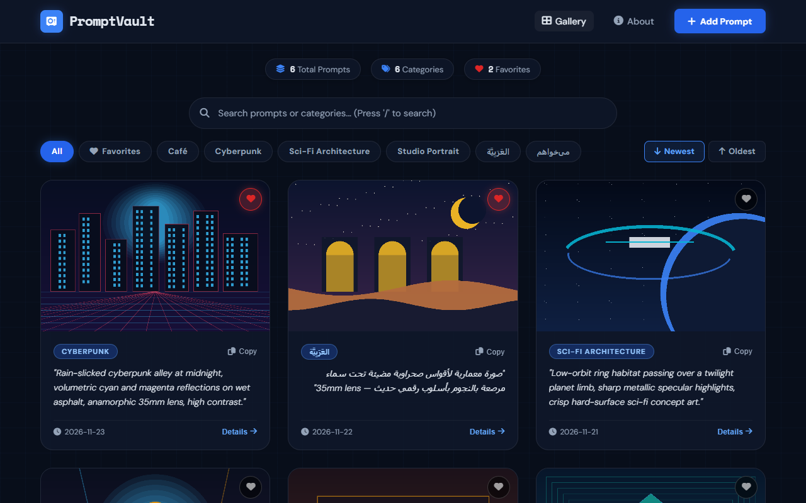

# PromptVault

[](https://github.com/Adel-dev-2001/PromptVault/actions/workflows/ci.yml)

PromptVault is a small Flask and SQLite web app for keeping generated images paired with the prompts, negative prompts, and settings used to produce them. Built by Adel Mohamed as a CS50x final project, it is meant as a single-user local tool and does not generate images, call external AI APIs, or manage multi-user accounts.

Links: [Static browser demo (GitHub Pages)](https://adel-dev-2001.github.io/PromptVault/) | [Video walkthrough](https://youtu.be/-prDHVKBQtc)

Note on the hosted demo: GitHub Pages serves only the static version in [index.html](index.html) and [static/js/demo.js](static/js/demo.js), which saves items in browser `localStorage` with no backend. Everything below describes the Flask server in [app.py](app.py).

## Screenshots

Captured with Playwright against a seeded local server:

| Desktop gallery (1280x800) | Detail modal (1280x800) |
| :---: | :---: |
|  |  |


## Features

- Browse saved artworks and prompts in a gallery paginated at 24 entries per page, with counts for total prompts, categories, and favorites.
- Search prompts and categories (press `/` to jump to the search field), filter by category or favorites, and sort newest or oldest first.
- Open any entry in a detail modal to read the full prompt, copy it to the clipboard, or download the original file, with keyboard focus trapping and Escape to close.
- Upload PNG, JPEG, GIF, or WebP images up to 10 MB via file picker or drag-and-drop with live preview and a prompt character counter.
- Edit prompt text, move entries between categories, toggle favorites, and delete entries along with their image files.
- Use Unicode category names (including Arabic, Persian, and accented letters) with automatic right-to-left text direction and a collapsible navigation menu on small screens.

## Architecture

- One Flask app ([app.py](app.py)) uses `cs50.SQL` with SQLite, Jinja2 templates, custom error pages, and dynamic robots and sitemap endpoints.
- Uploaded images live outside static assets under `data/uploads/` and are served through explicit media and download routes.
- SQLite stores relative paths so `url_for` links work under prefixes, and startup migrates legacy uploads without overwriting (warning on collisions).
- Relative configured paths resolve from `app.root_path`, failed inserts delete saved files, and category edits move files and prune empty folders.
- Gallery queries count totals in SQL, paginate 24 items per page (`?page=N`), redirect overflow pages, and emit prev, next, and canonical links.
- Deferred browser scripts in `static/js/` handle the focus-trapping modal, mobile menu, clipboard copy, and upload previews with no build step.
- Static assets use versioned long-term caching, uploaded media revalidates with `ETag`, and form pages send no-store cache headers.

## Project layout

- `app.py`, `wsgi.py`: Flask application and WSGI entry point
- `templates/`: Jinja2 views and HTTP error templates (`400`, `404`, `405`, `413`, `500`)
- `static/`: Stylesheet, deferred scripts (`js/main.js`, `js/gallery.js`, `js/form.js`, `js/demo.js`), manifest, and icons
- `data/uploads/`: Default local directory for uploaded image files (ignored by Git)
- `index.html`, `404.html`, `robots.txt`, `sitemap.xml`: Static GitHub Pages demo files
- `scripts/make_social_card.py`: Pillow generator for `og-card.png` and PNG app icons
- `test_app.py`: Automated `unittest` suite
- `Dockerfile`, `docker-compose.yml`, `Procfile`: Container and deployment config
- `requirements.txt`, `requirements-dev.txt`, `pyproject.toml`: Pinned dependencies and Ruff settings
- `docs/screenshots/`, `CHANGELOG.md`, `SECURITY.md`: Screenshots, release log, and security policy

## Quick start

Requires Python 3.11-3.13 and `pip`.

```bash
git clone https://github.com/Adel-dev-2001/PromptVault.git
cd PromptVault
python -m venv .venv
```

Activate the virtual environment:

- Windows (PowerShell): `.\.venv\Scripts\Activate.ps1`
- macOS / Linux: `source .venv/bin/activate`

Install dependencies and run locally:

```bash
pip install -r requirements.txt
python app.py
```

Open `http://127.0.0.1:5000`. In local development (`APP_ENV` unset or `development`), a missing or placeholder `SECRET_KEY` generates a temporary key and logs one startup warning.

For production, `wsgi.py`, `Procfile` (`web: APP_ENV=production gunicorn wsgi:app`), and `Dockerfile` set `APP_ENV=production`, which raises `RuntimeError` at startup unless `SECRET_KEY` is at least 32 characters and not a placeholder:

```bash
export APP_ENV=production
export SECRET_KEY="$(python -c 'import secrets; print(secrets.token_hex(32))')"
gunicorn --workers 4 --bind 127.0.0.1:5000 wsgi:app
```

`gunicorn==27.0.1` is pinned in `requirements.txt` for POSIX/Linux deployments.

## Configuration

See [.env.example](.env.example) for a starting template.

| Variable | Default | Purpose |
| :--- | :--- | :--- |
| `APP_ENV` | `development` (`production` in `wsgi.py`, `Procfile`, `Dockerfile`) | Enables mandatory `SECRET_KEY` validation and `SESSION_COOKIE_SECURE` when set to `production`. |
| `SECRET_KEY` | Temporary random key in local dev | Signs Flask sessions and CSRF tokens. Must be at least 32 characters and non-placeholder in production. |
| `DATABASE_PATH` | `<app_root>/prompts.db` (`/app/data/prompts.db` in Docker) | SQLite database path; relative values resolve from `app.root_path`. Commented out in `.env.example`. |
| `UPLOAD_FOLDER` | `<app_root>/data/uploads` (`/app/data/uploads` in Docker) | Upload directory; relative values resolve from `app.root_path`. Commented out in `.env.example`. |
| `APP_PASSWORD` | Empty (disabled) | Enables HTTP Basic auth on all routes except `/robots.txt` and `/static/`. See [Security](#security). |
| `HOST` | `127.0.0.1` | Bind address for `python app.py`. |
| `PORT` | `5000` | Listen port for `python app.py`. |
| `FLASK_DEBUG` | `0` | Enables Flask debug mode when set to `1`. |
| `TRUST_PROXY` | `0` | Enables Werkzeug `ProxyFix` (`x_for=1`, `x_proto=1`, `x_host=1`, `x_prefix=1`) when set to `1` behind a reverse proxy. |

## Tests and checks

Run the unit test suite (uses temporary directories and leaves no files in the repo):

```bash
python -m unittest -v test_app.py
```

Run linting, formatting, and dependency auditing:

```bash
pip install -r requirements-dev.txt
ruff check .
ruff format --check .
pip-audit -r requirements.txt
```

Regenerate PNG social card and app icons if needed:

```bash
python scripts/make_social_card.py
```

## Docker

`Dockerfile` builds a single-stage `python:3.13-slim` image running as non-root `appuser` owning `/app/data`, with `APP_ENV=production`, `DATABASE_PATH=/app/data/prompts.db`, `UPLOAD_FOLDER=/app/data/uploads`, and a Python `urllib.request` health check against `http://127.0.0.1:5000/robots.txt`. `docker-compose.yml` binds `127.0.0.1:5000:5000`, mounts a single named volume (`promptvault_data`) at `/app/data` for both the database and uploaded images, and requires `SECRET_KEY` from the host environment.

```bash
export SECRET_KEY="$(python -c 'import secrets; print(secrets.token_hex(32))')"
docker compose up -d --build
```

Production mode sets `SESSION_COOKIE_SECURE=True`. When running the Docker container locally over plain HTTP, open `http://localhost:5000` in Chrome or Firefox (which treat `localhost` as a trustworthy origin for `Secure` cookies); Safari may drop the session cookie on plain HTTP and trigger CSRF errors on forms.

## Security

PromptVault is built as a single-user local tool by default. See [SECURITY.md](SECURITY.md) for reporting vulnerabilities.

What is protected:

- All `POST` routes (`/add`, `/edit/<id>`, `/favorite/<id>`, `/delete/<id>`) verify `Flask-WTF` CSRF tokens.
- Setting `APP_PASSWORD` requires HTTP Basic authentication (`hmac.compare_digest`, username ignored) on every route except an explicit allow-list (`robots_txt` and `static`). Because uploads live outside `static/` in `data/uploads/` behind `/media/` and `/download/`, uploaded files require credentials by default and cannot be reached through `/static/` path tricks.
- Uploads are capped at 10 MB, limited to `png`, `jpg`, `jpeg`, `gif`, and `webp`, verified for matching binary format via Pillow, checked against a 20,000,000-pixel per-frame limit (including animated GIF/WebP frames), and saved with `secure_filename`.
- Category names are NFC-normalized, collapse runs of ASCII spaces, and allow only 1-30 characters from Unicode letters (`L*`), combining marks (`M*`), digits (`N*`), space, `-`, `_`, ZWNJ (`U+200C`), and ZWJ (`U+200D`), rejecting other control/format characters and strings without letters or digits. `/media/<path>` and `/download/<path>` reject null bytes, backslashes, percent signs, and empty/`.`/`..` segments, and check `os.path.commonpath` against `UPLOAD_FOLDER`.
- SQL queries bind user input as parameters (`?`), `LIKE` search escapes `%`, `_`, and `\`, Jinja autoescaping handles HTML/attribute output, and responses set `Content-Security-Policy` (`script-src 'self'`, `img-src 'self' data: blob:`, no `'unsafe-inline'`), `X-Content-Type-Options: nosniff`, `X-Frame-Options: SAMEORIGIN`, `Referrer-Policy`, `Permissions-Policy`, and `Strict-Transport-Security` over HTTPS (with `ProxyFix` when `TRUST_PROXY=1`). `/favorite/<id>` redirects only to same-origin referrers.

What is not protected:

- There are no multi-user accounts or role permissions; `APP_PASSWORD` is a single shared password and ignores the Basic auth username.
- Requests and authentication attempts are not rate-limited.
- There is no malware scanning beyond Pillow decoding and format verification.

Do not expose this server directly to the internet without `APP_PASSWORD` set and a TLS-terminating reverse proxy in front of it (`TRUST_PROXY=1`).

## Known limitations

- Running multiple Gunicorn workers (`--workers=4`) against SQLite relies on SQLite file locking and suits single-user or light usage rather than concurrent write-heavy traffic.
- Animated GIF and WebP uploads check the 20,000,000-pixel ceiling per individual frame within the 10 MB request cap rather than summing pixels across all frames.
- The GitHub Pages static demo (`index.html`) stores entries only in browser `localStorage`, renders all entries on one page without pagination, and cannot perform server-side Pillow verification.

## License

MIT License. Created by Adel Mohamed ([GitHub](https://github.com/Adel-dev-2001)). See [LICENSE](LICENSE).
